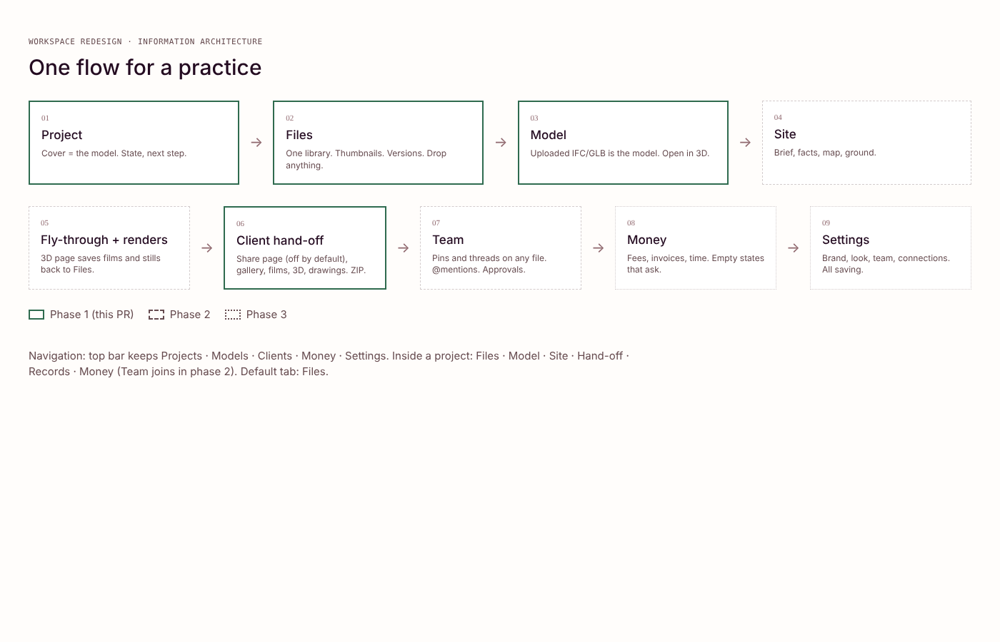
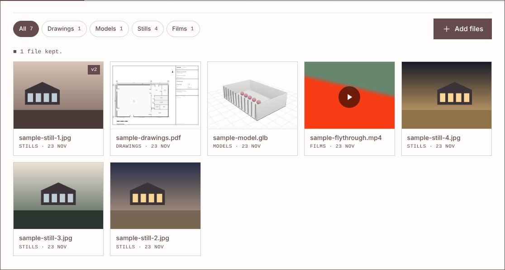
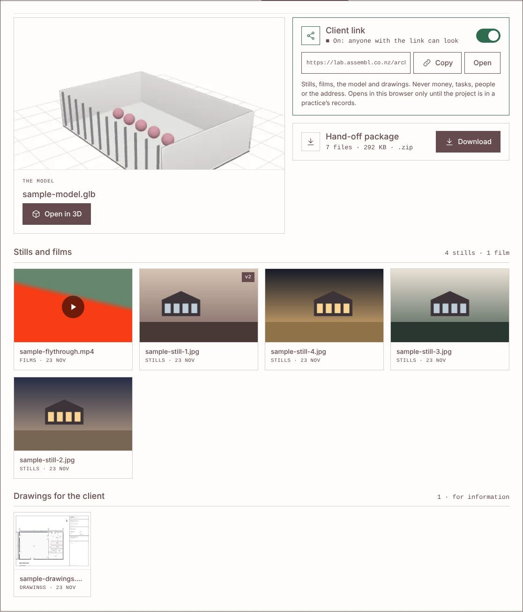
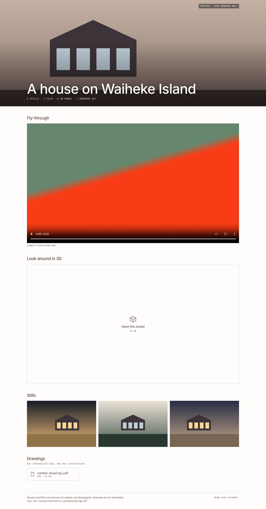
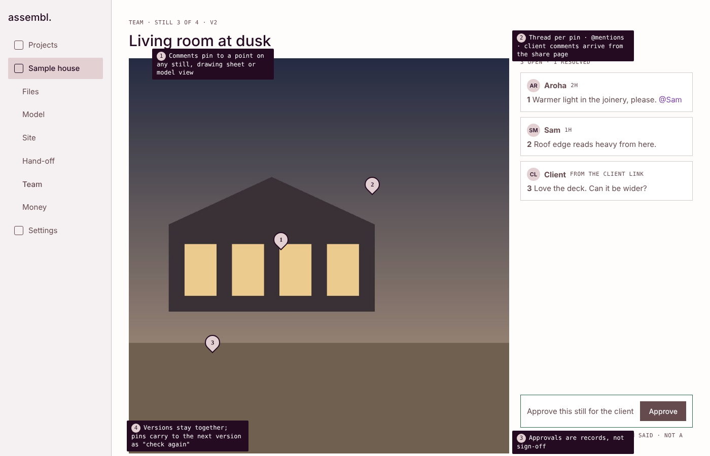
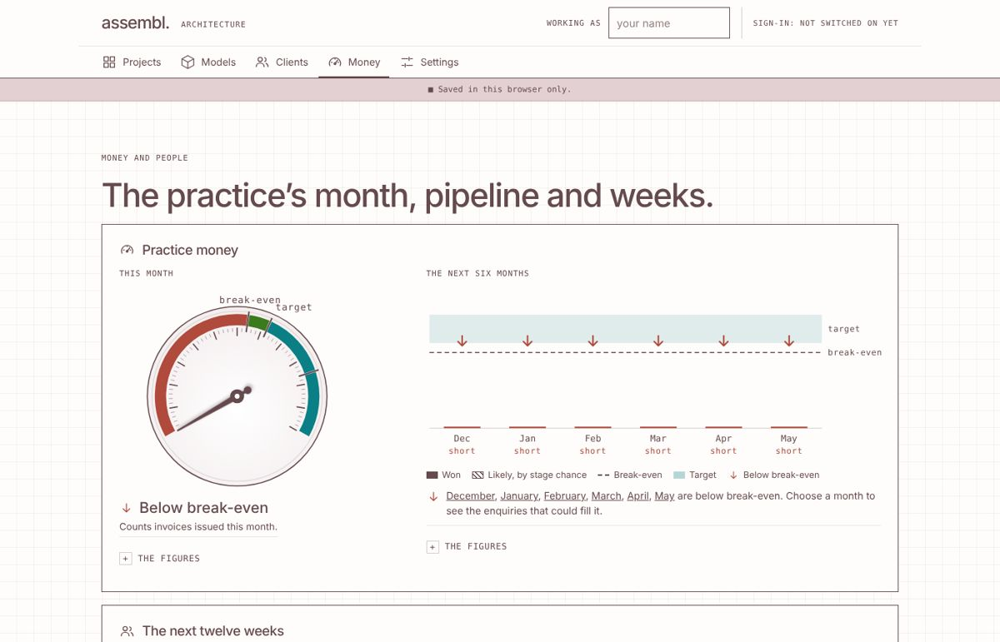
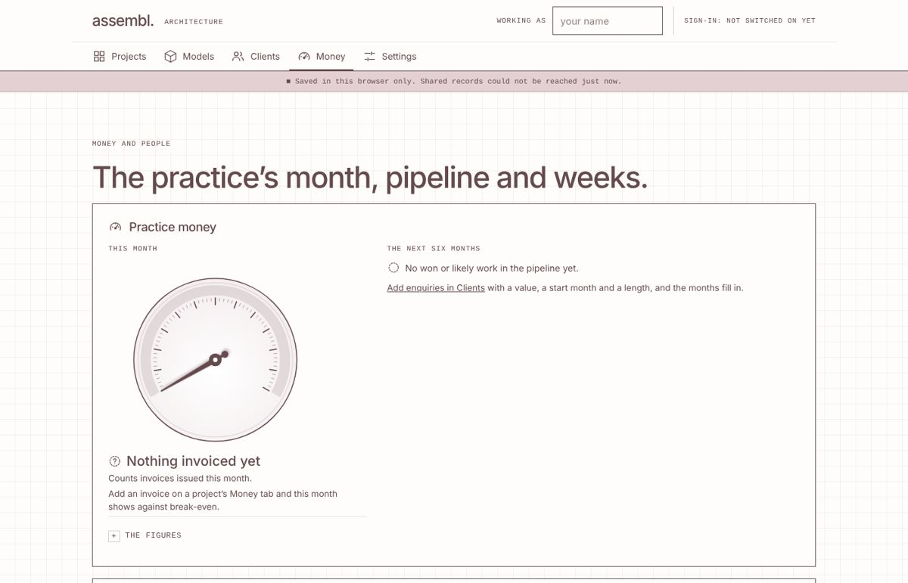
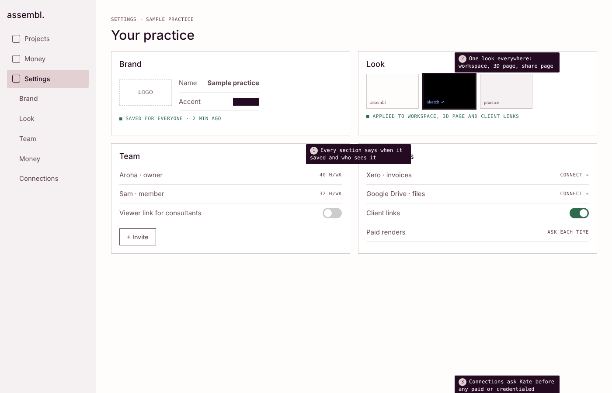

# The architecture workspace: redesign

Status: phase 1 built on `feat/workspace-redesign-p1` (draft, checked on the Sample project, signed out). Phases 2 and 3 are proposed.
Owner of the decisions in "What Kate decides" below: Kate.

Kate's brief, in her words: the operating system is not flowing; it has none of the drawings; settings don't work; money doesn't
really work; the models are there but not interesting; no way to download or export fly-throughs or make a hand-off for a client;
no collaborative space; the assets are poor. It needs a look over the UX and UI of the whole system. Visual first, few words.

Mockup stills sit beside this file in `workspace-redesign/` (Sample project and invented data only).

## 1. What the audit found

Run on the Sample project, signed out, at 1400×900 and 390×844, every page and tab, every control tried. Line numbers are on
`origin/main` before this branch.

| # | What a person sees | Why | Where |
|---|---|---|---|
| 1 | Project header and wall tile say **No model yet** while a GLB is attached in Site and sources and the Models page lists it | the cover looks only at the plan model JSON (`project.model`) | `architecture/js/app.js:181` |
| 2 | Presentation says **No model to show in 3D yet** with a model attached | same: `twinLink(p.model)` reads the plan model only | `app.js:433` |
| 3 | Model tab head says **□ Not attached** above a Models section holding an IFC | same | `app.js:410` |
| 4 | Site tab's walkthrough strip says **No model or drawing set yet** on the Sample, which has a plan model | `hasModel` counts only `owner_kind: 'model'` files | `site-sources.js:182`, `site-sources-rules.js:183` |
| 5 | Drawings tab says **No documents yet** while a drawing set and a site plan sit in Site and sources | Drawings lists document records only; sources and models are separate file systems | `app.js:423` |
| 6 | Four different places to upload a file (Drawings "Add a file", Intake drop, seven Site and sources slots, Models drop), each keeping it differently | grown separately | `app.js:423`, `intake.js:280`, `site-sources.js:425`, `models.js:603` |
| 7 | Films and stills: each new upload shows as a new **version** of one file, so only the newest is visible | sources stack by slot (`stackKey` returns the slot for everything but "other") | `site-sources-rules.js:68` |
| 8 | Site and sources appears **twice** after uploads (signed in) | a newer draw replaces the page while an older draw is still adding sections; the older one appends into the new page | `app.js:699`, `app.js:797` |
| 9 | Practice money with a break-even typed and no invoices: dial says **Below break-even**, all six months say **short** | empty data treated as zero revenue | `money-model.js:287`, `money-model.js:335`, `money.js:198` |
| 10 | Project Money: **Fee left** gauge draws a red arc with no fee or rate typed | the gauge is drawn whatever the data | `money.js:276` |
| 11 | Saving the money settings shows **"The assembl look is saved in this browser"** | an add-on's redraw keeps the page's last message | `app.js:765` |
| 12 | Presentation is mostly a furniture catalogue of studio product pictures | the library registers in the Presentation tab | `library.js:18` |
| 13 | No client link, no download package, no way to export a fly-through | "A link a client can open… Not built yet"; twin sharing not configured | `app.js:432`, `app.js:440`, `functions/api/twin-share.js:5` |
| 14 | No comments, mentions or shared review on any file, still or model | not built | (none) |
| 15 | "Client: No client linked yet" sits in the Model tab | the CRM panel defaults to the Model tab | `crm.js:663` |
| 16 | Takeoff tab is one sentence: "Quantities from the model, coming" | placeholder tab | `app.js:445` |
| 17 | The project page spends ~1,150 px (desktop) on cover, dial, next step, stage strip and four counters before any work shows; ~2,300 px on a phone | layout | `app.js` `dashView` |
| 18 | Empty charts take a full panel ("The next twelve weeks" draws an empty axis) | no empty state | `money.js:585` |
| 19 | Long standing notes under every screen | footer paragraphs | `architecture/index.html:42` |
| 20 | Library pictures are slow or blank in full-page captures | lazy images; not checked further in a real browser | `library-view.js:63` (uncertain) |

Checked and working, signed out: the look (assembl / sketch) saves and survives a reload; the money settings save and come
back after a reload; Export downloads the project file. Not checked: anything signed in (the shared records were not reachable
from the test browser), so "settings don't work" for a signed-in practice is not reproduced here; see phase 3.

## 2. The flow

One flow for a practice, the same order on every project:

1. **Project**: the cover is the model (a still of it when there is one); its state and the one next step.
2. **Files**: one library. Every drawing, model, site file, photo, still and film once, as a thumbnail, with its versions. Drop
   anything anywhere on it.
3. **Model**: one model concept. The uploaded IFC or GLB is the model, wherever it was uploaded. The plan model JSON the plan reader
   writes is an internal detail the 3D page reads plans from; it is "the model" only when nothing has been uploaded.
4. **Site**: brief, facts, map, ground.
5. **Fly-through and renders**: made on the 3D page, saved back to Files as films and stills.
6. **Client hand-off**: a read-only page per project in the practice's look: stills gallery, films, a 3D view to look around,
   drawings for information. Off until an owner turns it on. A download package (.zip) of the same things.
7. **Team**: comments and @mentions pinned to any file, still or model view; activity; approvals as records.
8. **Money**: fees, invoices, time; empty states that ask for the missing number instead of showing a bad result.
9. **Settings**: practice brand, look, team, connections; each saves and says so.

### Navigation

- Top bar (unchanged): Projects · Models · Clients · Money · Settings.
- Inside a project: **Files · Model · Site · Hand-off · Records · Money** (Team joins in phase 2). Files opens first.
- Records holds the stage gate, approvals, consent bundle, RFIs, variations, observations, defects and the client link to the CRM.
- Takeoff is off the page until it measures something.

### Rules for every screen

- A picture before a sentence. A number before a paragraph. One line of text where there was three.
- Empty is empty: an empty state shows what goes there and the one action that fills it. It never shows a bad result.
- Every saved thing says where it was saved and who sees it.
- In the practice's look (assembl or sketch; practice brand in phase 3). Tokens from `ops.css` only.
- Agents prepare, people approve. No screen says a design complies. An approval is a record of what a named person said.

## 3. Screens

### Files (phase 1, built)

- Filter chips with counts: All · Drawings · Models · Site · Photos · Stills · Films · Other (only the kinds present show).
- Tiles: a real thumbnail (picture, first frame of a film, first sheet of a PDF, a still of a GLB or IFC), the name, the kind and
  the date. A version badge (v2, v3) when the same name and kind came in again.
- Open a tile: the file large (picture, film player, first sheet), Download, its versions with a download each, and Open in 3D for
  the project's model.
- Drop files anywhere on the library, or Add files. Files are kept as sources (`owner_kind: 'source'`) in the slot the 3D page
  reads (PDFs as the drawing set, pictures and films as films and stills); a big file in a practice's records goes up in parts.
- Records with no file yet are listed under the grid ("3 records without a file · Attach").
- Empty: one big drop area, "Drop drawings, models, photos and films here."

### Model (phase 1: one concept)

The head names the uploaded model. The plan model is folded under "Plan model · read from the drawings" once an IFC or GLB is
uploaded; the furniture library moved here from Presentation.

### Hand-off (phase 1, built)

- The model, large, with Open in 3D.
- **Client link**: a switch, off by default. On, it shows the link with Copy and Open. Off, the old link stops working (the token
  goes; on again makes a new one). Signed out it is a preview that opens only in this browser.
- **Hand-off package**: file count, size, Download. A .zip of stills, films, drawings (PDF) and the model, with a read-me that
  says renders are not photographs and drawings are not for construction.
- Stills and films gallery; drawings for the client.

### The client page (phase 1, built): `/architecture/share/?t=<token>`

A full-bleed hero still with the project's name, the fly-through films, "Look around in 3D" (an orbit view in the page), the other
stills, the drawings (for information only), one line of small print. No money, tasks, people, site files, photos, site point or
address, ever. A wrong, old or turned-off link shows "This project is not shared."

For a practice's records the page asks `/api/arch-share`, which reads `arch.shared_project(token)` with a server-side key and signs
one-hour file links. That needs the migration `20261123200000_arch_project_share.sql` and the Cloudflare secret
`ARCH_SHARE_SERVICE_KEY` (Kate's decision; until then the page says client links are not switched on).

### Team (phase 2, comments and pins built on `feat/workspace-comments`; approvals and the notifications tray still proposed)

- Pins on a point of any still, drawing sheet or model view; a thread per pin; @mentions notify in the workspace.
- Client comments arrive from the client page (a name and a comment; no account), marked as from the client link.
- Approve a still, film or drawing set for the client: a record of who said it and when, never a sign-off.
- Pins carry to the next version as "check again".
- An activity feed per project and per person.

### Money (phase 1 empty states; phase 3 depth)

Before (break-even typed, nothing invoiced): 

After: 

- Phase 1: with nothing invoiced the dial is neutral and says "Nothing invoiced yet" with the one step that fills it; with nothing
  in the pipeline the six months say so instead of "short"; the fee-left gauge is not drawn without a fee and a rate.
- Phase 3: invoices from Xero (read), time from a timer on the project page, fee stages with a % complete per stage, and the twelve
  weeks chart only when there is a team.

### Settings (phase 3, proposed)

Brand (name, logo, accent), Look (assembl, sketch, practice), Team (people, hours, roles, a viewer link for consultants),
Connections (Xero, Drive, client links, paid renders "ask each time"). Every section shows "Saved for everyone · 2 min ago" or
"Saved in this browser only".

## 4. Phases

### Phase 1: remove the contradictions, one file library, gallery, hand-off page (this branch)

Done:
- One model: `primaryModel()` (an uploaded IFC/GLB anywhere wins; the plan model otherwise) drives the cover, the wall tiles, the
  Model tab head and the Hand-off.
- One library: `file-library-rules.js` (rules) + `file-library.js` (the Files tab and Hand-off), reading documents, models and
  sources together. Films and stills each show as their own tile.
- Hand-off: client link (off by default; owner-only for a practice; token rotates on off), package .zip (`zip-write.js`, no outside
  library), gallery, drawings.
- The client page `architecture/share/` and `functions/api/arch-share.js`; migration `20261123200000_arch_project_share.sql`
  (not applied).
- No duplicate sections after uploads (a stale draw stops adding sections).
- Money empty states; no misleading "look saved" message after saving money.
- Tabs: Files · Model · Site · Hand-off · Records · Money; Takeoff off; furniture library to Model; CRM client to Records; footer
  notes folded.

Still to do in phase 1 (small, next):
- The Site tab's walkthrough strip still uses the old model test (`site-sources.js`, owned by another branch): switch it to
  `primaryModel()` when that branch lands.
- A compact project header (cover, state and next step in one row of ~360 px) so Files shows without scrolling.
- Make the 3D page save stills and films straight into Files (it saves to the Films and stills slot today, which the library reads).

### Phase 2: collaboration

Built (comments, pins, @mentions, client comments; the migration `20261123220000_arch_comments.sql` is not applied):
- A comments rail beside the large file viewer in Files and Hand-off; on a still, numbered pins at a point (x, y as 0 to 1 fractions).
- A Team tab per project: the project's comments (filters: project, files, pins, client, mentions me) and its activity.
- The client page: a comment button under the hero, each still and each film, and a "Say something" note for the project. A name and
  a comment; no email. Comments stop working when the link is turned off, and a new link does not open the old client comments.
- Plain text, 2,000 characters; links are shown as text, never clickable. Owners alone hide or delete. Rate limited by link and by
  address (8 in 10 minutes for one address, 40 an hour for a link), counted in the database; `functions/api/arch-comments.js`.
- The Sample project, and anyone signed out, keep comments in this browser.

Original scope: comments and pins on files, stills, drawing sheets and model views; @mentions and a notifications tray; client comments from the
client page; approvals per file; activity per person. Needs: a `comment` table with row level security (members write; the client
page writes through the server with the share token, rate-limited), a decision on client identity (name only, or email link).

### Phase 3: money and settings depth

Practice brand (logo and accent applied to the workspace, 3D page and client page), team management, connections (Xero invoices
read-only, Drive), fee stages, timers, a real twelve-week capacity view. Needs Kate's choices on which services to connect.

## 5. What Kate decides

1. Apply the migration `20261123200000_arch_project_share.sql` and add the Cloudflare secret `ARCH_SHARE_SERVICE_KEY` (the
   Supabase service key, kept in Cloudflare only) so client links work for practices. Until then they work as a browser preview.
2. Phase 2: may a client comment with a name only, or must they confirm an email address first? Decided: a name only.
3. Phase 3: which connections (Xero, Google Drive, others), and whether any paid service is wanted.
4. Whether the Takeoff tab comes back only once quantities are measured from the model (proposed), or as a placeholder.
