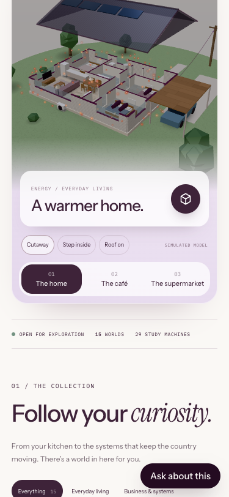

# Main-site embed corrections (draft)

Companion to main-site PR https://github.com/katecoveny-svg/assemblnz-f0afd79d/pull/1667.

- Mobile world selectors now use three equal columns, wrap labels and retain 48px tap targets. At 375px each button measured clientWidth=scrollWidth=99px; all three complete labels are visible.
- Both company return links use `target="_top"`: in standalone use they navigate normally; embedded use leaves the frame rather than nesting the company homepage.
- Browser verified home/café/store selector title changes and the Build with assembl link navigating the top-level page to `https://www.assembl.co.nz/` with one remaining frame (the top document).
- Only `index.html` and `lab/lab.css` change runtime behaviour. Shared stage, vendor, posters, all simulation pages and Kimi source assets are untouched.
- JavaScript syntax checks passed for existing lab.js and preview-bridge.js; diff whitespace checks passed. This static repository has no build/typecheck/test scripts. API feeds aren't served by the local static server; this check does not validate backend freshness.
- `/capture/` and `/capture/train/` are already public on the independent Lab. Neither this PR nor the main-site wrapper adds a link to them. The main wrapper embeds the existing root and does not gate arbitrary upstream routes: future Lab navigation changes could expose more routes through it. Proper capture-route access control is a separate owner-reviewed change. No training dependencies were installed/run and no imagery was uploaded.

