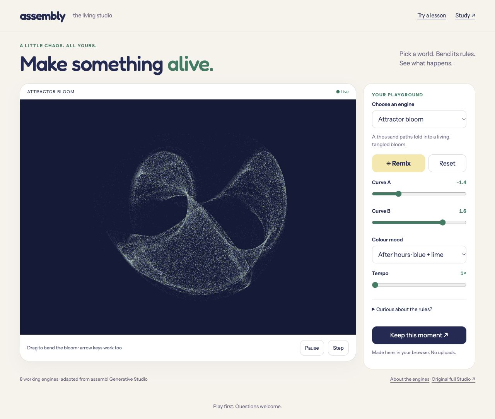
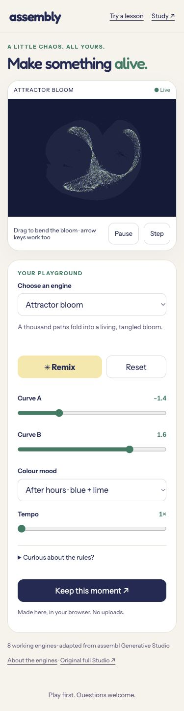

# Living studio visual review

These page-only screenshots show `/study/patterns/` served locally from application commit `600b57eaaefadb87b084fbbb3d7c1af573079b19`, after the control precision and Murmuration contrast fixes. They contain generated artwork and public interface text only, with no account data or browser chrome.

- [Desktop](desktop.jpg): Attractor bloom in the After hours palette, with the living canvas and controls side by side.
- [375px mobile](mobile-375.jpg): full-page capture using a 375 × 812 browser viewport. Canvas and controls stack, with formatted curve values and no horizontal clipping observed.

The artwork changes during animation, so the frames differ. Mobile evidence is browser viewport emulation, not a physical iPhone test. These still images document layout, not animation; separate ordinary-browser interaction checks exercised all eight engines. Native share delivery and physical printing remain unverified.

## Follow-up export review

The subsequent caption guard rejects an overfull footer visibly before offering a download, retaining the user's input. Ordinary IAB confirmed a ten-line square caption is blocked and a two-line caption succeeds. Automated canvas-layout tests cover square, portrait and wide dimensions, explicit newlines and a 240-character unbroken word. The shared word input now states its 12-character limit, and Murmuration renders that same length. The screenshots above precede only these targeted text/export changes; their canvas layout is unchanged.
